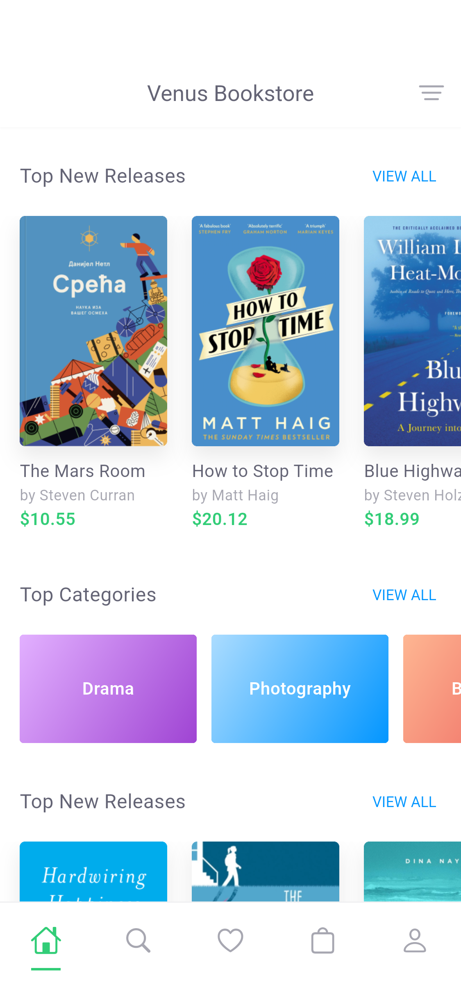
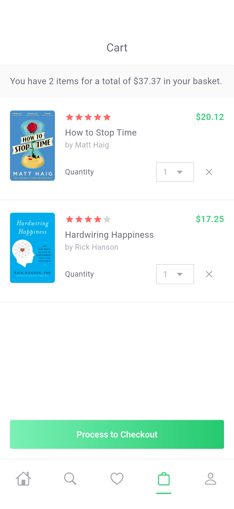
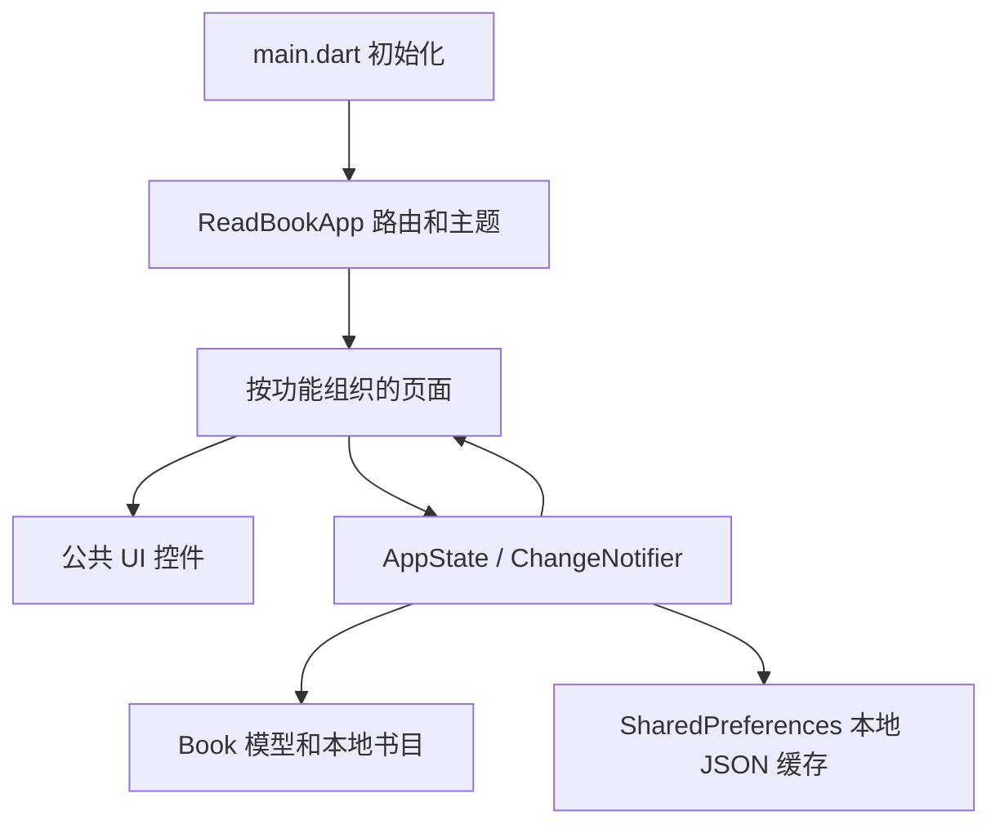

# ReadBook · Venus Bookstore

依据 Pixso 提供的书店 UI 开发的 Flutter App。包含全部 **16 个设计页面**，并补充订单确认和订单历史，使浏览、搜索、收藏、购物车、结算形成可操作的完整演示流程。

本项目为本地演示 App：书目是静态示例，账户是本地演示身份，结算不会发起真实支付。界面沿用设计稿英文文案。

## 主要界面

下图由 Android 模拟器中实际运行的 Flutter App 截图组成。


| 浏览首页 | 书籍详情 | 购物车 |
| --- | --- | --- |
|  |  |  |

全部页面截图及长页面下半部分见 [截图索引](docs/SCREENSHOTS.md)。

## 启动

开发环境：Flutter 3.41.6、Dart 3.11.4；依赖的实际版本由 `pubspec.lock` 固定。

```bash
flutter pub get
flutter run
```

指定设备或运行 Web：

```bash
flutter devices
flutter run -d emulator-5554
flutter run -d chrome
```

工程包含 Android、iOS、Web 平台目录。实际运行验证使用 Android 15 / API 35 模拟器；iOS 需要本机可用的 Xcode 运行时及签名环境。

## 项目结构与架构

```text
ReadBook/
├── lib/
│   ├── main.dart                     # Flutter 初始化、本地缓存加载、系统栏
│   ├── app.dart                      # MaterialApp 与路由组装
│   ├── core/
│   │   ├── theme.dart                # 颜色、文字、表单、主题
│   │   └── widgets.dart              # 页面骨架、导航、按钮、书卡、空状态
│   ├── data/
│   │   ├── catalog.dart              # Book 模型、示例书目、作者、分类、运费
│   │   └── app_state.dart            # ChangeNotifier 状态、本地保存、金额计算
│   └── features/
│       ├── catalog/                  # 首页、分类、详情、作者、搜索与筛选
│       ├── collection/               # 心愿单、书签、作者书目、购物车
│       ├── account/                  # 账户、登录注册、个人中心、订单记录
│       └── checkout/                 # 地址、配送、付款、订单成功
├── assets/images/                    # 从 Pixso 导出的真实书封与头像
├── test/                             # 状态逻辑、缓存、界面与交互测试
├── integration_test/app_test.dart     # Android 全页面检查、完整下单、自动截图
├── test_driver/screenshot_driver.dart # 将设备截图写入 docs/screenshots/
├── tool/make_contact_sheets.py        # 截图总览生成脚本
├── docs/
│   ├── SCREENSHOTS.md                 # 所有截图及页面入口
│   ├── DESIGN_MAPPING.md              # Pixso 页面映射、素材与实现差异
│   ├── VALIDATION.md                  # 验证环境、命令与结果
│   ├── screenshots/                  # App 实际运行截图
│   └── reference/                    # 16 张设计参考与原始导出代码归档
├── android/ ios/ web/                 # 平台工程
└── pubspec.yaml / pubspec.lock
```

采用按功能划分的轻量架构，页面通过 `AppState` 操作数据，`ListenableBuilder` 订阅变化；公共控件负责一致的视觉与交互。无需额外状态管理或路由框架。



金额统一使用整数美分，避免浮点金额累加误差。运费随配送选项计算，购物车总额由真实商品单价和数量推导。收藏、书签、购物车、用户名和订单会保存在设备上，写入串行执行以避免快速连续操作导致旧状态覆盖新状态。

地址仅在本次运行中使用；密码、银行卡号和 CVV 不保存。当前没有真实身份认证、服务端订单、库存或第三方支付接口。接入服务端时，可从 `AppState` 中替换数据读写与下单逻辑，保留功能页面及公共组件。

## 功能与页面

| 模块 | 页面 / 能力 |
| --- | --- |
| 首页与发现 | 横向新书列表、分类入口、推荐横幅、作者入口 |
| 分类 | 分类目录、双列书籍网格、空分类状态 |
| 书籍详情 | 书封、作者、评分、简介展开、图书信息、评论点赞、收藏、书签、加入购物车 |
| 作者 | 分组作者列表、作者书目；示例作者无对应书籍时显示空状态 |
| 搜索筛选 | 按标题/作者/分类搜索，作者、分类、语言、出版年、价格范围筛选；结果数量和清空功能 |
| 收藏 | 心愿单移除与批量加入购物车；书签独立管理 |
| 购物车 | 数量 1–20、移除、动态合计、空购物车状态 |
| 结算 | 地址必填校验、国家/城市联动、四种配送方式、付款字段校验、演示下单 |
| 账户 | 登录/注册校验、本地登录与退出、个人中心、帮助、关于、订单历史 |

示例登录可使用任意非空用户名和至少 6 位密码。注册需要有效格式邮箱及一致的确认密码。Facebook / Google Plus 按钮保留设计外观，点击会说明未接入服务；不模拟真实 OAuth 成功。

## 代码精简

Pixso 自动导出的逐图层代码已归档到 `docs/reference/pixso-generated.zip`，不参与编译。运行代码移除了绝对定位和重复状态栏图层，以 Flutter 布局、系统安全区与公共组件实现。购物车、心愿单、书签共用书籍列表组件；结算、筛选共用表单标签与按钮；全站使用统一主题和页面骨架。App 无在线图片依赖。运行 Dart 源码从原始导出的约 405 KB 整理为约 84 KB，并补齐交互逻辑。

设计稿所用 Circular Std 字体未附带可分发字体文件，当前采用系统字体；图标使用 Flutter/Cupertino 图标。书封与头像直接取自设计稿。更多说明见 [设计映射](docs/DESIGN_MAPPING.md)。

## 验证与截图重建

```bash
flutter analyze
flutter test
flutter drive -d emulator-5554 \
  --driver=test_driver/screenshot_driver.dart \
  --target=integration_test/app_test.dart
python3 tool/make_contact_sheets.py
```

最后一个脚本需要 Pillow，仅用于文档图集，不属于 App 运行依赖。自动截图测试使用独立内存状态，避免改写正常运行 App 的本地收藏和购物车。

构建 Android 安装包：

```bash
flutter build apk --release --target-platform android-arm64
```

当前 Android 工程保留 Flutter 模板的调试签名设置，适合本地安装验证；正式发布前需配置发布签名。详细验证结果见 [验证记录](docs/VALIDATION.md)。
