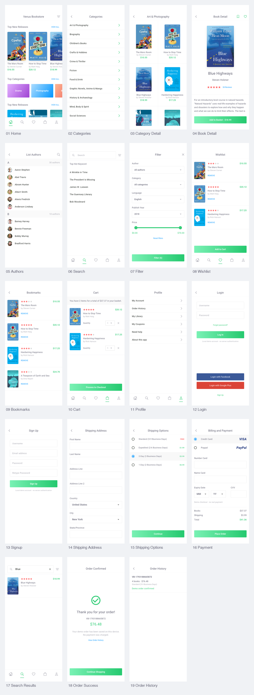

# 页面截图索引

截图来自 Android 15（API 35）arm64 模拟器，Flutter 实际渲染，画面为 1125 × 2436 像素。系统安全区和键盘行为遵循 Android 平台，不伪造设计稿中的 iOS 状态栏。

## Pixso 中的 16 个界面

| 序号 | 页面 | 截图 | 在 App 中进入 |
| --- | --- | --- | --- |
| 01 | 首页 | [Home](screenshots/01_home.png) | 启动 App / 底部首页 |
| 02 | 分类目录 | [Categories](screenshots/02_categories.png) | 首页 Top Categories → VIEW ALL |
| 03 | 分类详情 | [Category Detail](screenshots/03_category_detail.png) | 分类 → Art & Photography |
| 04 | 书籍详情 | [Book Detail](screenshots/04_book_detail.png) | 点击书封或书名 |
| 05 | 作者列表 | [Authors](screenshots/05_authors.png) | 首页下方 Discover Authors |
| 06 | 搜索 | [Search](screenshots/06_search.png) | 底部搜索 |
| 07 | 筛选 | [Filter](screenshots/07_filter.png) | 首页/搜索右上角筛选 |
| 08 | 心愿单 | [Wishlist](screenshots/08_wishlist.png) | 底部爱心 |
| 09 | 书签 | [Bookmarks](screenshots/09_bookmarks.png) | Profile → My Library |
| 10 | 购物车 | [Cart](screenshots/10_cart.png) | 底部购物袋 |
| 11 | 个人中心 | [Profile](screenshots/11_profile.png) | 底部个人中心 |
| 12 | 登录 | [Login](screenshots/12_login.png) | Profile → My Account |
| 13 | 注册 | [Sign Up](screenshots/13_signup.png) | Login → Sign Up |
| 14 | 收货地址 | [Shipping Address](screenshots/14_shipping_address.png) | Cart → Process to Checkout |
| 15 | 配送选项 | [Shipping Options](screenshots/15_shipping_options.png) | 完成地址 → Continue |
| 16 | 账单与付款 | [Payment](screenshots/16_payment.png) | 配送选项 → Continue |

## 补充截图

| 说明 | 截图 |
| --- | --- |
| 首页下半部分 | [Home bottom](screenshots/01_home_bottom.png) |
| 图书信息及评论 | [Book detail bottom](screenshots/04_book_detail_bottom.png) |
| 地址页下半部分与继续按钮 | [Shipping address bottom](screenshots/14_shipping_address_bottom.png) |
| 实际输入 Blue 后的搜索结果 | [Search results](screenshots/17_search_results.png) |
| 本地下单成功 | [Order success](screenshots/18_order_success.png) |
| 演示订单记录 | [Order history](screenshots/19_order_history.png) |

主要流程图集：[main_flows.png](screenshots/main_flows.png)。原始设计参考位于 [reference](reference/)，文件编号与上述页面对应。App 截图与设计参考分开保存，便于比较。
